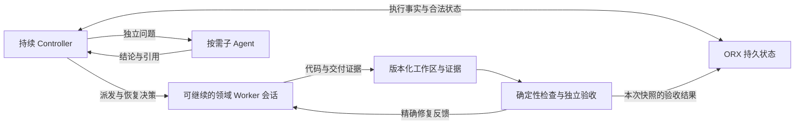

# Agent 会话、上下文与并发成本：对 ORX 的研究分析

研究日期：2026-10-07。范围：官方产品文档、厂商工程实践、论文与 ORX 当前源码。产品能力以查阅日期为准；论文结果保留原实验条件。本报告没有运行付费模型对照实验，因此不给出 ORX 已节省多少费用的结论。

## 1. 判断先行

你的担忧成立，但需要把三个问题分开：

1. **子 agent 能否保留上下文？** 可以，取决于 harness 是否保存并恢复会话，以及调度器是否使用这个能力。新的模型调用、新的进程、新的会话、同一会话的新一轮不是一回事。
2. **保留 session 是否更省钱？** 有时。它能减少重复探索和失败经验丢失，也有利于保留缓存前缀；但历史上下文仍有处理和计费成本。很长、过期或带错误假设的 session 也可能更贵。
3. **controller/worker 是否存在机制缺陷？** 存在固有的信息交接、同步和集成成本，但不是必然失败的架构。问题是把每次任务和重试都做成全新、窄输入的执行，且没有上下文充分性检查、会话延续和恢复策略。

**对个人开发的建议：持续的主会话或领域 worker 承担紧密相关的实现与修复；按需派发并行读取、独立实现和独立审查。ORX 保持执行事实与验收状态的权威，把“谁执行”和“用新会话还是继续旧会话”作为两个不同的决策。** 这是本报告的设计判断，不是厂商性能保证。

## 2. “无记忆”到底指哪一层

| 层次 | 保存什么 | 能否延续 | 是否自动出现在下一次模型输入 |
| --- | --- | --- | --- |
| 模型参数 | 训练得到的知识与能力 | 不因一次编码任务自行更新 | 不包含用户这次任务的经历 |
| 会话历史 | 消息、工具调用与结果、部分产品的压缩状态 | harness 可保存、恢复或分叉 | 取决于 harness 的输入构造 |
| 外部任务记忆 | 决策、检查点、失败记录、任务契约 | 可以跨进程、跨 provider | 必须注入或按需检索 |
| 工作环境 | 文件、Git 状态、测试产物、数据库、容器 | 生命周期由系统管理 | 文件存在不等于模型已经读过 |
| KV/prompt cache | 相同前缀的计算状态 | 有生命周期和路由条件 | 是计算复用，不是业务记忆 |

普通推理调用不会通过修改模型权重记住刚才做的事情。用户感受到的“agent 有记忆”，主要来自 harness 将相关历史或外部资料带到下一次调用。

OpenAI 的 Conversations API 可以保存长期会话对象，Responses 也能通过历史或 `previous_response_id` 续接；官方明确说明，后者仍会将链中先前输入作为输入计费。[Conversation state](https://developers.openai.com/api/docs/guides/conversation-state)

因此：

- **同进程 ≠ 同上下文。** 一个常驻 CLI 也可以每次创建全新 thread。
- **新进程 ≠ 无上下文。** 一个新 CLI 进程可以恢复已持久化 thread。
- **同 session ≠ 完整记忆。** 上下文可能已经被压缩、裁剪或检索替换。
- **同目录 ≠ 共享决策。** agent 可以看见其他人的代码，却不知道为什么这样实现。
- **同模型 ≠ 同一个 agent。** 会话、工具与环境绑定才决定具体执行身份。

## 3. 派发有五种不同方式

| 方式 | 上下文来源 | 适合的工作 | 成本与质量风险 |
| --- | --- | --- | --- |
| 全新会话 + 自包含契约 | 任务输入、必要文件与证据 | 清楚、短、可独立验收的工作 | 契约不足时重复探索或猜测 |
| 从父会话分叉 | 父会话截至分叉点的历史 | 需要已有讨论与探索的任务 | 复制大量无关历史；继承错误假设 |
| 继续原 worker | 原 worker 历史 + 最新反馈 | 同一实现的测试修复、局部追加 | 长历史、锚定偏差、环境已变 |
| 检查点恢复 | 精简状态 + 可追溯产物 | 会话丢失、跨模型接棒、长任务切换 | 摘要遗漏导致重新推导 |
| 按领域维持会话 | 多个相关任务的领域知识 | 连续修改同一子系统 | 知识过期、会话污染、身份与资源管理 |

**Resume 是继续一条历史；fork 是从一个历史点产生新的分支。** fork 后子 agent 不会自然知道父会话之后作出的决定，父 agent 也不会自动得到子 agent 的所有中间经历。需要结果回传、决策记录和必要的增量通知。

Codex 的 SDK 支持重复调用同一 thread 的 `run()`，也支持 `resumeThread(id)`；app-server 暴露 `thread/resume` 和 `thread/fork`，后者能选择历史截点。[Codex SDK](https://learn.chatgpt.com/docs/codex-sdk)、[App-server](https://learn.chatgpt.com/docs/app-server)

当前聊天的子 agent 工具还允许选择继承全部历史、部分历史或不继承，并可向已有子 agent 派发后续工作。这是本次会话暴露的工具能力，不能推定其他客户端或 ORX 已有相同实现。

## 4. Token 数、费用、延迟不是同一目标

### 4.1 计算单位应是“一个通过验收的 Goal”

仅看 worker 的输入 token，容易漏掉：规划、controller 判断、worker 推理与工具循环、verifier、失败尝试、重复读仓库、压缩调用、最终集成与复验。

使用同一模型的简化成本表示：

```text
C_goal = Σ调用 (I_uncached × p_input
               + I_cache_read × p_cache_read
               + I_cache_write × p_cache_write
               + O × p_output)
         + 工具/环境费用
```

这里三种输入类别应按 provider 口径去重；output 包括该 provider 计入输出的推理 token。多模型时每次调用分别用自己的价格。缓存写入如采用独立费率，应使用该类别的完整费率，不能再重复加普通输入费。

OpenAI 当前官方说明：root 与 subagent、重试、工具与环境都要计入；推理 token 已包含在输出中，不能再加一次。部分 usage 为 best-effort，且某些会话用量字段不提供缓存写入细分，因此不能由它们确定最终账单。[Observability and usage](https://developers.openai.com/api/docs/guides/agents-api/observability)

至少同时比较：成功率、每个通过验收 Goal 的成本、完成时间、人工干预时间。固定预算下比较质量、固定质量下比较成本、固定截止时间下比较产出，是三种不同实验。

### 4.2 历史会被重复消费，缓存只是降低其中的价格

没有裁剪时，若起始上下文为 H，每步新增约 d，执行 n 次调用，累计输入约为：

```text
nH + d × n(n−1)/2
```

这是理想化模型：真实工具输出、裁剪与压缩会改变增长。它解释为什么“只增加了一万字历史”可能在后续多次调用中被重复消费。缓存可使其中的大部分前缀按较低费率计费，但没有把上下文变成免费。

缓存匹配依赖稳定前缀和有效缓存；session ID 本身不是缓存命中的保证。压缩会改变前缀，但更短的后续输入仍可能使总体更便宜，应比较总费用。[Prompt caching](https://developers.openai.com/api/docs/guides/prompt-caching)

### 4.3 同一 session 修复不保证比新会话便宜

下面只计算一次后续调用的**输入部分**。假设历史 40k token，修复反馈 1k，缓存读取费率为普通输入的 0.1 倍；新会话交接包 4k：

| 后续方式 | 等价普通输入 token 成本 |
| --- | ---: |
| Resume，40k 全部缓存命中 | 40k × 0.1 + 1k = 5k |
| Resume，历史未命中 | 40k + 1k = 41k |
| 新会话，交接包未命中 | 4k |

这**没有**计算交接包生成、可能的缓存写入、后续多轮和重新探索。若新会话必须重读并重新推理，它很可能更贵；若新会话只需精确改动，而旧历史巨大且无关，它可能更便宜。

因此真正判断是：

```text
继续旧会话的历史成本 + 修复成本 + 锚定偏差风险
  对比
交接成本 + 新会话输入成本 + 重建知识成本 + 遗漏风险
```

### 4.4 并行主要压缩完成时间

两个独立 worker 同时各跑 10 分钟，总用量通常仍是两个 worker 的用量，再加协调与集成；时间可能接近 10 分钟，而非 20 分钟。共享 provider 的速率限制、环境容量和集成耗时可能削弱这个收益。

令可并行部分比例为 f，worker 数为 k，理想时间下界近似：

```text
T_parallel ≥ T_serial × ((1−f) + f/k)
             + 派发/同步/集成开销
```

这不是 token 节省公式。单 agent 发起多个独立读取、并行运行检查，也能取得一部分速度收益，不需要增加承担推理的 agent。

## 5. 为什么很多编码任务由主 agent 连续做更划算

以下判断来自上述机制与编码工作特点，不是统一基准结果。

### 5.1 省掉重复建立问题模型

一次深度调试形成的知识，不只是“改哪个文件”，还包括复现条件、已经排除的解释、配置约束、数据流、失败假设和测试行为。把它交给新 worker 的成本可能比接着修高得多。

主 agent 已经探索到一个局部修复方案，再请 planner、worker、verifier 各重新理解，容易出现三个会话重复支付同一份发现成本。角色可以仍然存在，但角色切换不必每次创建全新的执行者。

### 5.2 避免压缩交接造成的隐含决策丢失

“支持分页”没有交代 offset 还是 cursor、排序稳定性、授权过滤、错误行为等决策。不同 worker 即使各自提交通过局部测试的实现，也可能不兼容。代码改动本身也携带隐含决策。

Cognition 在 2025-06 的工程文章强调共享相关上下文与动作中的隐含决策，主张连续执行和专门压缩。它是工程观点，文章关于当时 Claude Code 能力的描述不能当成 2026 产品事实。[Don’t Build Multi-Agents](https://cognition.com/blog/dont-build-multi-agents)

### 5.3 单会话压缩也有代价

摘要可能遗漏关键事实，较长历史可能使不相关信息干扰判断；连续 agent 也可能反复执着于自己的错误解释。尤其是独立审查，给审查者全部 builder 推理会增加结论被预设叙事影响的风险。

OpenAI 的原生 compaction 可以用更少 token 携带先前状态与推理，产物是 opaque 的压缩项，不能等同于普通可读摘要。[Compaction](https://developers.openai.com/api/docs/guides/compaction)

本报告由此建议：有原生压缩时优先使用；同时维护可读、可追溯的决策与证据，以支持核查和跨 provider 恢复。压缩后的会话状态和项目事实记录用途不同。

## 6. 多 agent 的结构性成本与真正优势

### 6.1 结构性成本

1. **交接损失。** 契约没包含执行所需决策，worker 就补充猜测。
2. **重复探索。** planner、worker、verifier 对同一仓库各读一遍。
3. **通信复制。** 同一事实发送给多条会话；广播与所有人互聊扩张成本。
4. **状态过期。** worker 保留旧接口理解，其他 agent 已经改了实现。
5. **集成成本。** 无文本冲突也可能有语义冲突；worktree 只解决一部分问题。
6. **协调与验收成为瓶颈。** 所有结果都经 controller，人和模型的核查吞吐有限。
7. **错误相关。** 相同模型、相同错误契约、相同摘要可能让多 agent 一起出错。
8. **成本归属不完整。** 主会话、host 与压缩费用未记录，会产生虚假的节省数字。

这不是“无记忆”一个开关能解决的。Resume 主要改善同一 worker 的连续性，不会自动同步多个 worker 的业务决策。

### 6.2 仍然值得并行的情况

- **读取与调查可分离。** 各研究不同依赖、各看不同日志，回来汇总可核查事实。
- **实现契约稳定。** 给定同一 API/schema，多个实现范围能独立验收与集成。
- **外部等待占比高。** 查询、浏览、测试等可以在独立环境中推进。
- **任务中间数据很大。** 子 agent 隔离大量噪声，只回传关键证据。
- **需要不同检查视角。** 安全、性能、验收审查有不同评价目标。
- **需要候选搜索。** 对难题生成多条候选路径，再用可靠测试或选择器比较。

最后一种通常是主动花更多算力提高成功机会，不应包装为省 token。多个结果若依赖同一个错误前提，“投票”也不能保证正确。

Codex 官方把隔离探索噪声、汇总结果和适合独立执行的工作列为主要价值，也说明可比较的多 agent 运行通常消耗更多 token。[Subagents](https://learn.chatgpt.com/docs/agent-configuration/subagents)

“独立”不一定是独立代码模块。读取任务即使研究同一模块，也能按明确问题并行；写入任务即使分属不同模块，若共同依赖尚未确定的领域模型，也可能不适合同时实施。

## 7. 实际派发前怎样判断

一个有用的测试是：**不看主会话，只凭派发包和指定资料，一个合格执行者能否做对，且能证明做对？** 如果不能，先补足输入、改成继承必要上下文、合并任务，或保留主会话执行。

| 工作形态 | 默认执行方式 | 理由 |
| --- | --- | --- |
| 连续需求澄清、跨模块架构选择 | 主会话或持续领域 worker | 决策密度高 |
| 同一 bug 的复现→修复→测试反馈 | 同 worker 继续 | 排除过的假设有价值 |
| 明确、很短的一次修复 | 主 agent 直接做 | 派发固定开销可能更大 |
| 对不同文件/依赖的只读调查 | 窄上下文并行子 agent | 输入与产物清楚 |
| 已冻结契约的独立模块 | 独立 worker，可并行 | 可分开验收；仍要集成测试 |
| 高耦合跨文件重构 | 一个持续实现者 | 局部动作持续影响整体 |
| builder 结果的独立验收 | 新 verifier，事实输入 | 避免完全继承 builder 结论 |
| verifier 发现的小问题 | 原 builder 接收反馈继续 | 不必重新学实现 |
| 原思路根本错误 | 新诊断上下文或重新规划 | 避免延续错误前提 |

不要把每个微小步骤都派成任务。任务粒度应覆盖一段有用的探索与修复循环，同时足够小，可以明确验收。

## 8. 恢复、继续与重试必须分开

| 发生了什么 | 首先做什么 | 通常是否新建 worker |
| --- | --- | --- |
| 一次工具调用暂时失败 | 在原工作流中重试工具，保留错误证据 | 否 |
| 连接断开，不清楚执行是否仍在运行 | 查询原执行与产物，恢复订阅或会话 | 否 |
| 测试发现局部代码错误 | 给原 builder 精确失败反馈 | 否 |
| 会话过长但思路正确 | 原生压缩，或有证据的检查点交接 | 未必 |
| 原模型或 provider 不可用 | 保留产物与状态，用可移交摘要接棒 | 可能 |
| 已证明错误假设，需要独立诊断 | 以事实重建输入，显式排除错误前提 | 可能 |
| 任务边界或目标发生变化 | 判断是否重规划，刷新受影响契约 | 视情况 |

**超时不等于死亡；死亡不等于代码要重做；验收失败不等于全部重规划。** 重新启动前需要确认当前写作者状态。否则重复 worker 会同时改目录，晚到交付又可能覆盖新结果。

重试反馈应说明：已完成什么、失败的具体检查、当前工作树/提交、日志路径、已排除假设、哪些事实更新了、下一步范围。不能只发送“失败了，再试一次”。

连续修复应有预算与停止条件。重复失败时，优先判断缺输入、环境阻塞、能力不足还是任务错误；增加 token 前先增加可用信息。不同失败类型采用不同恢复路径，比统一“新 worker + 更强模型”更合理。

检查点建议保持七项：目标与约束、当前 revision 与代码版本、产物位置、确定的决策及原因、失败/排除的尝试、未解决问题、下一步与验收入口。完整日志留在外部，仅把高价值索引带进上下文。

Manus 的工程实践强调稳定缓存前缀、文件系统外部记忆、可恢复压缩和保留失败证据。这些是产品经验，不是所有任务的最优策略。[Context Engineering for AI Agents](https://manus.im/blog/Context-Engineering-for-AI-Agents-Lessons-from-Building-Manus)

## 9. ORX 当前实现与研究问题的关系

核查基线：本次读取的 checkout HEAD `32606a8`。以下结论针对该版本；没有查询或推断全部用户实际运行费用。

| 当前证据 | 已经解决什么 | 仍然没有解决什么 |
| --- | --- | --- |
| Codex adapter 的新启动带 `--ephemeral` | ORX 不依赖原生会话文件完成一次执行 | 可恢复的持续 Codex worker |
| Cursor adapter 构造新 print 调用，未使用 resume 参数 | 独立调用与模型解析 | 原会话延续调度 |
| `session_ref` 被记录；host running 指派可重浮出 | 追踪原执行、避免盲目第二写作者 | 原生会话生命周期管理 |
| `_prior_failure_context` 携带失败检查与日志路径 | 重试不是完全失忆 | 先前完整探索与隐含决策复用 |
| 重规划引用与证据链 | 可追溯旧成果，避免仅靠任务编号继承 | worker 的认知状态自动迁移 |
| `host_context` 路由与技能规则 | 部分依赖主会话的工作留在 host | 普通高耦合实现的动态会话选择 |
| CLI 有效并行度为 1 | 共享工作树的写入风险受控 | 并行 worktree 与集成调度 |

源码依据：[Codex adapter](../src/orx/adapters/codex.py)、[Cursor adapter](../src/orx/adapters/cursor.py)、[派发与失败上下文](../src/orx/dispatch.py)、[Controller 契约](../skills/orx-controller/SKILL.md)、[职责边界](responsibilities.md)。

**这意味着，当前 ORX 的主要收益是控制、证据、验收和恢复纪律，不能宣称已经取得写入并发收益。** Fresh CLI 重试确有重复理解风险；但项目已经保留了失败证据、成果引用与 host 状态，不能称为“每次从零、没有记忆”。

还要区分：同一 worker 内的 `检查→修复→再检查` 循环和 ORX `task retry`。前者可以发生在原会话/开放 attempt 内；后者会产生新的执行尝试。交付门禁拒绝不一定立即关闭 attempt，更不应自动变成新进程。

ORX 的 token 字段目前保留 harness 原生语义。文档明确指出 Cursor 的 cache read 可能大于 input，禁止直接相减、跨 harness 重标口径或从当前数据库推算费用。NULL 也是未知，不是零。[Observability contract](observability-contract.md)

## 10. 对 ORX 的设计建议：先补连续性，再扩大并发

本节是研究建议，未实现，也不构成新增已确认的领域模型或实施计划。

### 10.1 会话身份与执行尝试身份分开

一个原生 worker session 可以承接多个执行轮次；一个 task 也可以因恢复或验收问题产生多个 attempt。会话延续不应绕过 ORX 的 assignment、revision、attempt 和验收有效性检查。

应明确三种情况：开放 attempt 中继续工作；关闭 attempt 后的新尝试复用旧历史；新任务引用领域 worker 的历史。当前 ORX 的晚到交付保护应保持，不能因为 resume 就接受旧身份的结果。

### 10.2 将执行模式与会话策略分别决策

执行模式回答 host/CLI/外部、使用哪个模型与环境；会话策略回答 fresh/resume/fork/checkpoint。二者不应由一个 driver 或 profile 字段隐含决定。

能力探测至少区分：能保存、能读取状态、能恢复、能分叉、能压缩、能取消、能确认取消。拥有 session ID 不能自动推出其仍存在、可恢复，或被当前身份授权访问。

Codex CLI 已有非交互 `exec resume` 的公开入口，且 SDK/app-server 提供更细生命周期。这说明技术上有可探索入口；ORX 接入前仍需用安装版本验证 flags、持久化、超时与计费语义。[Developer commands](https://learn.chatgpt.com/docs/developer-commands)

### 10.3 持续 worker 是按相关工作复用，不是所有任务共用一个大历史

连续修复同一子系统优先原 worker；不相关工作使用干净上下文；开始新工作前验证代码版本、任务范围、工具与权限、领域契约版本和关键事实是否过期。

不要跨 provider 移交原生 opaque 推理或压缩项并假定兼容。可移交的共同基础是项目事实、代码、证据和可读检查点。

### 10.4 验证分层，降低重复阅读

确定性检查由现有工具执行；语义验收输入包括冻结的具体 diff、验收条件、测试证据和必要领域决策；反馈精确交给原 builder。高耦合改动由一个持续实现者负责，独立审查按风险拆分。

这里的“冻结”需标记实际代码快照：审查期间代码变了，原判断不直接代表新快照通过。worktree、共享目录和会话的版本都需要对应。

### 10.5 只把必要信息送进模型

长日志落盘，先用工具过滤；搜索命中返回相关片段；状态查询返回变化和证据索引；共用资料通过稳定前缀或版本化引用复用；避免每次派发把全部历史和全部规则重写一遍。

Anthropic 的 MCP code execution 示例展示按需工具定义与程序内过滤可大幅缩小上下文（示例 150k→2k，98.7%）；这是特定示例，不能外推为 ORX 的收益。[Code execution with MCP](https://www.anthropic.com/engineering/code-execution-with-mcp)

### 10.6 控制层与认知层相互补足

ORX 记录目标、指派、尝试、证据和验收；原生 harness 管理会话、工具循环、压缩与恢复。确定性的状态与路由检查优先用程序完成，不必为每次合法状态转移额外调用一个 LLM。

下面是建议的职责分配示意，不是已经实现的运行图：



2026-08 的 OpenAI harness 文章和 2026-09 public beta 的 Agents API 都强调把状态延续、工具执行与恢复交给现有 harness。可借鉴职责边界，但产品可用性与迁移成本还须单独评估。[Codex as a platform](https://developers.openai.com/blog/codex-as-a-platform)、[Agents API](https://developers.openai.com/api/docs/guides/agents-api/overview)、[API changelog](https://developers.openai.com/api/docs/changelog)

## 11. 怎样用数据判断单 agent、持续 worker 与一次性 worker

建议先做受控评估，不先实现完整 worker pool。选取少量真实任务，各类至少多个样本：局部修复、多轮调试、稳定契约的独立实现、跨模块重构。

比较四种策略：

1. 主会话连续执行，保留原生压缩。
2. 一次性 worker + 自包含任务包。
3. 持续 worker + 增量测试反馈。
4. 对确实可分的任务使用并行 worker + 同样的集成验收。

控制起始提交、验收要求、环境、模型/推理投入、预算上限和停止规则；随机化运行顺序并记录实际缓存表现。缓存冷/热是实验条件，不能默认天然公平。对照样本可随机分配策略；重复运行同一问题需说明任务熟悉度与缓存的影响。

| 指标 | 意义 |
| --- | --- |
| 通过验收数 / 尝试的 Goal 数 | 成功率 |
| 全部评估费用 / 通过验收的 Goal 数 | 包含失败任务的成功交付成本；零成功时单独报告 |
| 每 Goal 的总账单与 token 分类 | 包括主 agent、worker、verifier、压缩和失败 |
| P50/P95 完成时间 | 体现并发收益与尾部恢复成本 |
| 人工介入时间与次数 | 衡量真实协作负担 |
| 重复探索、交接与集成所占用量 | 区分浪费在哪里 |
| 每次重试新增了什么信息 | 区分学习式修复与盲重跑 |
| 用量观测覆盖率 | 防止未知被当作零 |

同时看成本—成功率—延迟曲线。不能只挑成功样本算便宜，不能把“更多缓存 token”直接当作节省，也不能把失败任务全额视为浪费：诊断和排除错误可能是必要工作。

## 12. 主流 coding agent / harness 的实际机制

下面按公开文档和固定源码区分机制。产品在快速演进；配置、版本、订阅与非交互模式会改变能力。这里没有对每个 CLI 做真实付费恢复测试。

| 产品/机制 | 上下文与继续执行 | 本次确认的边界 |
| --- | --- | --- |
| Codex thread / SDK / app-server | thread 可继续、恢复和分叉；有原生上下文管理 | 原生接口存在，不代表 ORX adapter 已接入；CLI ephemeral 会话不提供普通持久化恢复基础 |
| Claude Code 普通 subagent / fork | 普通子 agent 从干净历史启动；fork 继承父历史；部分子 agent 可按 ID resume | 当前 general-purpose/custom 可恢复；Explore/Plan 是 one-shot，无 ID、不可恢复；子会话有自己的压缩与 transcript |
| Claude Code Agent teams | teammate 有独立上下文、共享任务与直接通信 | 不继承 lead conversation；当前 `/resume` 不恢复 in-process teammates；同一运行中唤醒和重启后恢复不同 |
| Cursor subagents | 干净上下文 + parent prompt；返回 agent ID，可 resume 原上下文 | 默认共用 checkout；并行写入需考虑隔离；文档不能证明任意重启、升级后无限耐久 |
| Cursor Projects | coordinator 委派工作，项目 context 用同步文件积累 | 长期共享知识不等于无限长的一次模型上下文 |
| Gemini CLI | 主会话可 resume；local subagent 有独立上下文循环 | 本次未找到等同主会话的 local subagent ID resume 承诺；浏览器 persistent profile 不是模型记忆 |
| OpenCode | 子代理形成 child session；TaskTool 的 `task_id` 可复用历史 | 固定源码中无效 ID 可回退新 session；必须核对实际返回身份与安装版本 |
| LangGraph | checkpointer 保存 thread 的工作流状态；store 可保存跨 thread 数据 | 恢复从 checkpoint 重放；未完成副作用可能重跑，仍需幂等与结果确认 |

来源：[Claude subagents](https://code.claude.com/docs/en/sub-agents#manage-subagent-context)、[Claude teams](https://code.claude.com/docs/en/agent-teams)、[Cursor subagents](https://cursor.com/docs/subagents#resuming-subagents)、[Cursor Projects](https://cursor.com/docs/agent/projects#shared-context)、[Gemini subagents](https://geminicli.com/docs/core/subagents/)、[Gemini session management](https://geminicli.com/docs/cli/session-management/)、[OpenCode TaskTool 固定提交](https://github.com/anomalyco/opencode/blob/ecc4916b5a9608c30e6dd58a67f2137b594407ca/packages/opencode/src/tool/task.ts#L136)、[LangGraph persistence](https://docs.langchain.com/oss/python/langgraph/persistence)、[LangGraph replay 与幂等](https://docs.langchain.com/oss/python/langgraph/functional-api#determinism)。Codex 来源见第 3 节。

Claude 的缓存文档进一步确认：resume 仍发送 conversation，相同前缀且 TTL 有效才命中。普通子 agent 的 system/tools 与父会话不同，初次通常不能复用父 cache；fork 可以复用，恢复子 agent 可复用自身 cache。是否继承历史与是否共享缓存需要分别验证。[Claude prompt caching](https://code.claude.com/docs/en/prompt-caching)

## 13. 厂商工程案例提供了什么证据

### 13.1 广度研究适合多 agent，但不提供编码省钱结论

Anthropic 在 2025-06 的内部研究任务评估中报告质量提升 90.2%。其“multi-agent 约 15× token”的基线是普通 chat，不能改写成“相对单 coding agent 贵 15 倍”；文章也指出共享上下文与强依赖任务的限制，并通过检查点恢复减少整轮重做。[Multi-agent research system](https://www.anthropic.com/engineering/multi-agent-research-system)

### 13.2 大规模编码遇到的是调度与一致性问题

Cursor 在 2026-01 的研究原型中发现平等 peers + locks 有等待和同步问题，后来使用 planner/worker/judge；integrator 曾成为瓶颈被删掉，周期性重启用于处理 drift。它是厂商原型经验，不能等同默认产品的调度实现或通用最优架构。[Scaling long-running autonomous coding](https://cursor.com/blog/scaling-agents)

### 13.3 16 个 agent 不会自动解决一个不可分的大瓶颈

Anthropic 2026-02 的 C compiler 实验使用 16 个 agent、近 2,000 个 Claude Code session、约 $20,000 API 费用。独立测试失败便于分工；面对 Linux 整体构建这个大问题时，多 agent 开始修同一 bug 相互干扰，改用 GCC oracle 分解测试才改善。案例使用 Git、任务锁与进度文件衔接 fresh sessions，没有 orchestration agent。[Building a C compiler](https://www.anthropic.com/engineering/building-c-compiler)

它说明外部记忆与可分解验证能支撑并发，但不是日常开发的性价比对照，更不是 compiler 生产质量的保证。

### 13.4 模型变化会改变最佳 harness

Anthropic 2025-11 提出的 initializer + 增量 fresh session 依靠功能清单、进度文件、Git 和端到端测试衔接工作。[Effective harnesses for long-running agents](https://www.anthropic.com/engineering/effective-harnesses-for-long-running-agents)

到 2026-03 的应用开发实验，Sonnet 4.5 需要 reset/handoff，Opus 4.5 后改成 continuous session + auto compaction，Opus 4.6 又去掉 sprint。部分旧机制成为额外开销，难验收问题仍受益于 evaluator。这是模型与任务相关的厂商经验，应通过删减消融评估自己的 harness。[Harness design for long-running application development](https://www.anthropic.com/engineering/harness-design-long-running-apps)

## 14. 论文研究：从“多几个 agent”走向预算、通信与可执行协作

选择代表性证据，不是穷尽综述。早期 MetaGPT/ChatDev 一类研究强调角色与开发流程；与本问题更相关的新工作开始测量总预算、失败来源、工作区集成、信息裁剪和跨任务记忆的负面效果。

### 14.1 直接软件开发并发证据：CAID，2026-03

CAID 使用中央依赖计划、异步工程师、独立 worktree、显式合并与测试。强依赖/循环依赖分组交给同一个工程师。在 Claude Sonnet 4.5 的 Commit0-Lite 结果中：

| 策略 | 平均测试通过率 | 平均 API 成本 | 平均运行时间 |
| --- | ---: | ---: | ---: |
| 单 agent | 53.1% | $1.8876 | 692.6 秒 |
| CAID，4 个工程师 | 59.1% | $8.1317 | 1583.2 秒 |
| 先单 agent，再 CAID | 59.5% | $10.0193 | 2275.8 秒 |

这些是测试通过率，**不是完整任务成功率**。相同模型与迭代上限不意味着全队消耗相同，故不能将质量提升全部归因于架构。作者明确报告更高 API 成本，并行没有显著缩短整体时间。它支持有条件的质量收益，也直接证明盲目先失败再整套多 agent 运行可以接近成本相加。[CAID 论文，表 2/4 与限制](https://arxiv.org/html/2603.21489v1)

### 14.2 用量与协作研究

| 研究 | 与问题相关的发现 | 不能据此推出 |
| --- | --- | --- |
| [AsynCodeBench，2026-09](https://arxiv.org/html/2609.32662v1) | 19 个仓库任务、显式依赖检查；平均测试分数改善时，完整任务成功率未必改善；测接口依赖比只看局部测试更有辨别力 | 小样本新预印本不能代表所有 coding agents；不是严格同总预算对照 |
| [Towards a Science of Scaling Agent Systems，2025-12](https://arxiv.org/html/2512.08296v1) | 180 配置；可并行工作与顺序任务表现不同；报告匹配推理预算，但不能据此确认全部通信/输入/输出账单等额 | 主要任务非 coding；经验阈值不是通用调度定律 |
| [MAST / Why Do Multi-Agent LLM Systems Fail?，v2，2025](https://arxiv.org/html/2503.13657v2) | 7 框架、200+ 轨迹归纳 14 类失败，包括历史丢失、信息未传递、重复工作、过早结束和验证问题 | 失败分类不是同预算的因果架构对照 |
| [AgentPrune，ICLR 2025](https://openreview.net/pdf?id=LkzuPorQ5L) | 裁剪冗余通信边，报告相对既有多 agent 框架降低 token 28.1–72.8% | 不是相对最佳单 agent 的节省；主要为数学/知识及函数生成 |
| [AgentDropout，ACL 2025](https://aclanthology.org/2025.acl-long.1170.pdf) | 按轮裁剪节点与边，报告 prompt/completion 相对多 agent 基线减少 21.6%/18.4% | 精简后的多 agent 仍可能远贵于单 agent；拓扑学习也有成本 |
| [Equal Thinking Token Budgets，2026-04](https://arxiv.org/html/2604.02460v1) | 控制推理预算上限时，多种拓扑未普遍胜过单 agent；实际用量也可能不同 | 多跳 QA 不能直接代表软件协作；上限相同不等于实际费用相同 |

### 14.3 简单 agent 与反馈式搜索都值得作为基线

| 研究/实现 | 说明什么 | 边界 |
| --- | --- | --- |
| [SWE-agent，2024](https://arxiv.org/html/2405.15793v3) | 工具界面与历史选择本身影响修复质量；保留所有 observation 的消融不一定更好 | 老模型、问题修复，不是现代多 worker 长开发对照 |
| [mini-SWE-agent 官方 FAQ](https://mini-swe-agent.com/latest/faq/) | 线性对话历史、简单工具循环可以构成强基线；每条命令独立执行不等于丢失 agent 历史 | 发布分数不能跨模型/日期归因于架构 |
| [Agentless，FSE 2025](https://lingming.cs.illinois.edu/publications/fse2025.pdf) | 定位→修补→验证的固定流程可有竞争力；无需把所有步骤做成自治角色 | 候选生成仍要预算；历史 Lite 实验不是任意 Goal |
| [SWE-Search，ICLR 2025](https://arxiv.org/html/2410.20285v3) | 保存状态、从分叉点扩展并用价值/选择器反馈，探索多条候选；部分附录有近似 compute-match | 多候选有成本；pass@k 的正确候选存在不代表部署时能选对；不是严格全账单预算相等 |

这些结果支持先把原生单 agent 的工具、观测与验证做好；难题才考虑受预算约束的分叉搜索或协作。不能只把次数从 1 改成 4，然后把发现率提高称为更高效率。

### 14.4 直接编码上下文证据：The Complexity Trap，2025-08

研究在 SWE-agent / SWE-bench Verified 上比较完整观察、旧 observation masking 和 LLM 摘要。Qwen3-Coder 480B 的表 1 报告：原始模式 53.4%、$1.29/任务；masking 54.8%、$0.61；摘要 53.8%、$0.64。masking 保留计划/行动历史，遮蔽较旧的工具观察，而非删除一切过去。

效果随模型变化，不能外推所有原生 compaction。它说明先减少重复日志/旧文件等低价值输入，有时比另加摘要 agent 更有效。[The Complexity Trap](https://arxiv.org/html/2508.21433v1)

### 14.5 记忆不是越多越好

| 研究 | 机制或结果 | 与 coding 并发的距离 |
| --- | --- | --- |
| [MemGPT，2023](https://arxiv.org/html/2310.08560v2) | 外部记忆分层，模型通过显式存取访问历史 | 记忆管理不是共享仓库一致性协议 |
| [A-MEM，NeurIPS 2025](https://arxiv.org/html/2502.12110v3) | 动态索引、链接和演化记忆，长会话 QA 受益 | 回答阶段上下文节省不等于创建/更新记忆全生命周期省钱 |
| [ACON，2025-10 / 2026](https://arxiv.org/html/2510.00615v3) | 通过压缩失败轨迹优化压缩准则；报告峰值 token 减少 26–54% | 峰值上下文不是总账单；不是 repo coding 主评测 |
| [CTIM-Rover，REALM 2025](https://aclanthology.org/2025.realm-1.30/) | 给 AutoCodeRover 加跨任务经验记忆，所测配置未胜过基线；无关条目可干扰 | 不能由一种经验记忆的失败否定准确项目状态或同任务续接 |

因此“为每个 worker 保存所有经历”不是目标。更好的问题是：怎样保留当前任务的高价值证据、正确检索它，并识别版本变化使什么知识失效。

可继续跟踪但本报告不采用其数字作为核心依据：[Tokenomics，2026-01](https://arxiv.org/html/2601.14470v1)、[Co-Saving，2025-05](https://arxiv.org/html/2505.21898v1)、[Engineering Sustainable Agents，2026-10](https://arxiv.org/html/2610.03010v1)。它们分别关注阶段费用、成功经验复用与能源/时间成本，实验口径尚不能直接替代 ORX 费用评估。

## 15. 研究边界与建议的优先次序

官方文档能证明接口存在，源码能证明当前 ORX 是否使用；厂商案例证明一种方法在一个案例中可行，论文结果只支持其任务、模型和预算条件内的判断。新的预印本尤其需要独立复现。

没有找到与 ORX 相同拓扑、同模型、同计费与缓存条件的“resume worker vs fresh worker vs 主会话压缩”严格实验。因此不能给出节省百分比。建议优先级是：

1. **先完整测量**：补齐主会话、worker、verifier、压缩与失败的口径和覆盖率。
2. **同一问题连续修复**：区分继续、恢复与重试，核对安装 harness 的能力。
3. **降低低价值输入**：长日志/重复观测外置，提供可检索的精确证据。
4. **检查派发充分性与依赖**：强依赖合并，契约明确后再分工。
5. **最后扩展写入并行**：工作区隔离、版本化集成、全局验收，再测收益是否值得。

不存在已经由这些资料证明的统一结论“多 agent 必然省钱”，也不存在“只有完全独立模块才允许子 agent”的统一限制。更稳妥的方向是减少重复推理、维持相关决策的连续性、把可验证的独立工作分出去、按失败类型恢复，并用完整成功交付成本选择策略。
